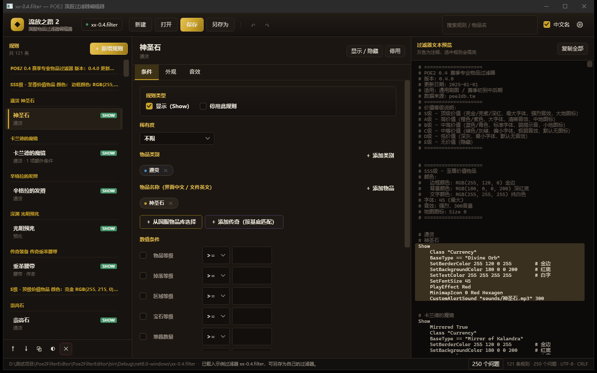

# POE2 国服物品过滤器编辑器

一个面向《流放之路 2》国服玩家的 `.filter` 可视化编辑器：**界面全部显示国服中文名，写进文件的是客户端匹配所需的英文内部名**，导出的过滤器国际服 / 国服通用。



## 为什么需要它

手写过滤器时，物品名只能写英文内部名（`BaseType "Divine Orb"`），但国服玩家并不熟悉这些英文。这个工具把「中文名 ↔ 英文内部名」的对照内置进来：

- 左侧规则列表直接显示「神圣石」「卡兰德的魔镜」，而不是 `Divine Orb`；
- 属性面板里的物品标签是中文，底层写回英文；
- 未知名称不会被改写，只会用琥珀色 `?` 标注并提示补录。

## 功能

**文件**

- 打开 / 新建 / 保存 / 另存为；保留原文件的 BOM、CRLF/LF、4 空格缩进、注释与空行。
- 未改动的规则原样写回，编辑过的规则才重新排版，避免「打开即产生大量 diff」。
- 保存采用「临时文件 + 原子替换」，并自动生成 `.bak` 备份。
- 记住上次打开的文件与目录，未保存时标题栏显示圆点，关闭前提示保存。

**规则编辑**

- 规则列表按注释块分组，Show / Hide 徽标区分，支持上移 / 下移 / 复制 / 停用（整块注释）/ 删除。
- 条件：稀有度、物品类别、物品名称、10 项数值条件（物品等级、掉落等级、区域等级、宝石等级、堆叠数量、品质、引路石阶级、已连接插槽、宽高）、4 项状态条件（腐化 / 鉴定 / 镜像 / 附魔）。
- 界面未覆盖的条件与无法识别的行都会原样保留，不会丢失。
- 外观：边框色、背景色、文字色（色板 + RGB 滑块 + HEX + 透明度）、字号、`PlayEffect`、`MinimapIcon`。
- 音效：`CustomAlertSound` 路径 + 音量 + 试听，可一键按中文名生成 `sounds/中文名.mp3`。
- 实时预览右侧同步刷新，点击预览块可反向定位规则；支持撤销 / 重做。

**校验**

底部问题栏汇总：未知指令、`==` / `>=` 等非标准比较符、颜色与字号越界、图标参数错误、音效文件缺失、类别与物品不匹配、规则重复等，双击可定位到对应规则。

**物品映射表**

- 内置 `Resources/items.json`：122 条物品、43 个类别，覆盖示例过滤器绝大部分 BaseType。
- 中文名直接取自 **poe2db.cn（流亡2编年史）的国服客户端数据**，2026-10 逐页抓取核对，例如 `Heavy Belt → 重革腰带`、`Artificer's Orb → 巧匠石`、`Soul Core of Tacati → 塔卡提的灵核`。
- 0.4 版本中不存在的条目（`Lesser Orb of Transmutation`、`Jeweller's Orb`、`Precursor Tablet` 等）已从表中移除，避免误导。
- 用户覆盖表 `%APPDATA%\Poe2FilterEditor\items.user.json`：界面里补录、或从设置里导入 JSON，同名条目优先；国服临时改名时无需等待程序更新。

## 运行

需要 .NET 8 桌面运行时（Windows 10 1809+ / Windows 11）。

```powershell
# 构建
dotnet build Poe2FilterEditor.sln

# 运行
dotnet run --project Poe2FilterEditor
```

首次启动会自动载入示例 `xx-0.4.filter`，直接「另存为」即可改成自己的过滤器。

## 快捷键

| 快捷键 | 功能 |
| --- | --- |
| `Ctrl+N` / `Ctrl+O` / `Ctrl+S` | 新建 / 打开 / 保存 |
| `Ctrl+Shift+S` | 另存为 |
| `Ctrl+Z` / `Ctrl+Y` | 撤销 / 重做 |
| `Ctrl+D` | 复制当前规则 |
| `Delete` | 删除当前规则 |
| `F5` | 重新载入文件 |

## 映射表格式

```json
{
  "version": "0.4",
  "classes": [{ "en": "Currency", "cn": "通货" }],
  "items": [
    { "en": "Divine Orb", "cn": "神圣石", "class": "Currency" },
    { "en": "Headhunter", "cn": "猎首", "class": "Belts", "unique": true }
  ]
}
```

详细说明见 [`Poe2FilterEditor/Resources/README-items.md`](Poe2FilterEditor/Resources/README-items.md)。

## 项目结构

```
Poe2FilterEditor/
├── Models/          规则、条件、动作、颜色等数据模型
├── Services/        解析器、写回器、物品库、校验、文件读写、设置
├── ViewModels/      主界面、规则、物品选择器
├── Views/           主窗口、物品选择器、取色器、设置
├── Themes/          暗黑金主题与控件样式
├── Infrastructure/  MVVM 基础、转换器、深色标题栏
└── Resources/       items.json 及说明
Poe2FilterEditor.Tests/  xunit 测试（解析往返、物品库、视图模型行为）
```

## 测试

```powershell
dotnet test Poe2FilterEditor.sln
```

覆盖：示例过滤器「解析 → 写回」零丢失往返、多值条件与行尾注释、停用规则、非标准比较符归一化、保存后重载、映射表双向查询与覆盖、规则标签增删与颜色修改等。

## 说明

- 本项目为玩家自制工具，与 Grinding Gear Games / 腾讯无关。
- 示例中引用的音效文件（`sounds/*.mp3`）不随仓库提供，需自行放入过滤器同目录的 `sounds` 文件夹；程序只做存在性提示。
